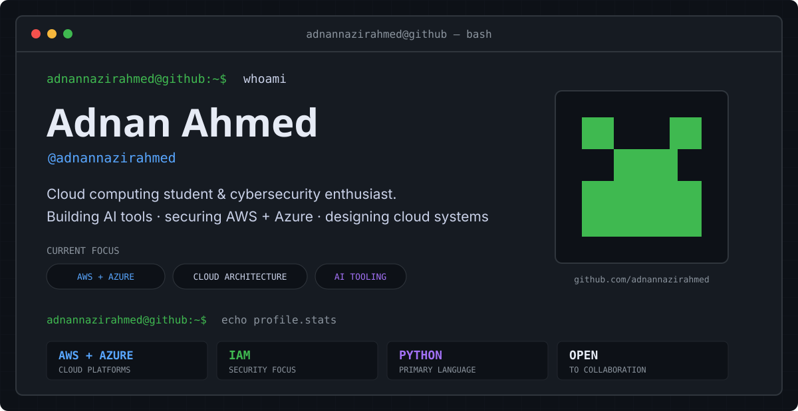
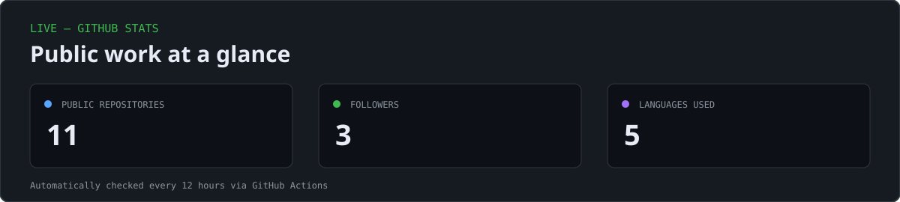
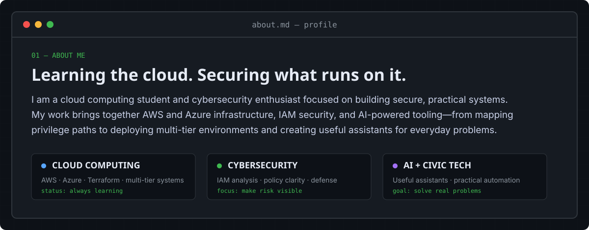
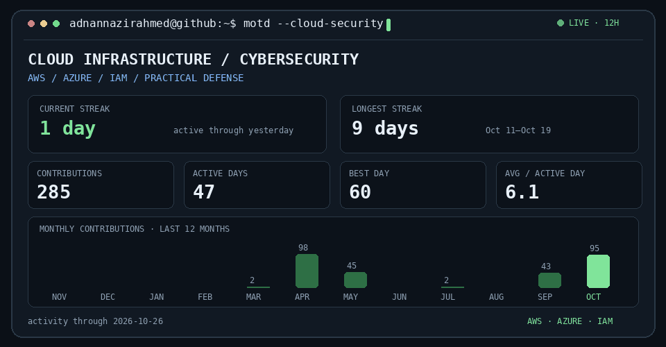
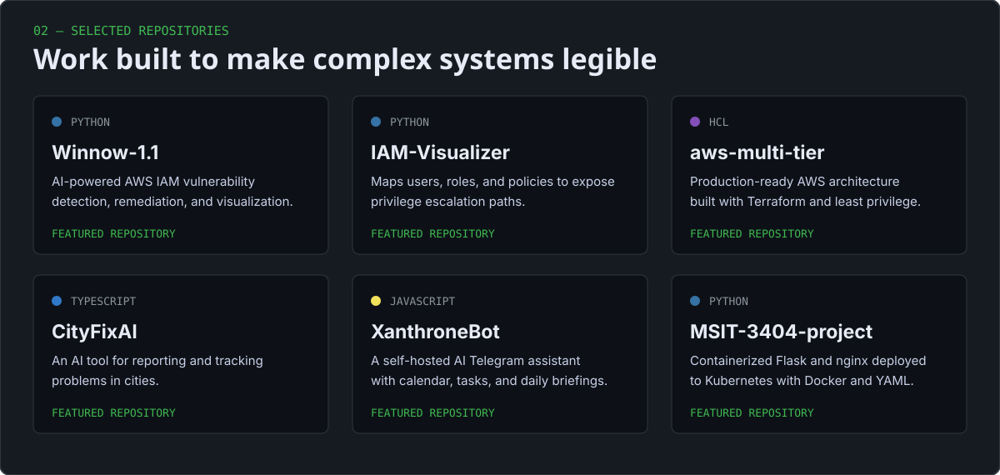
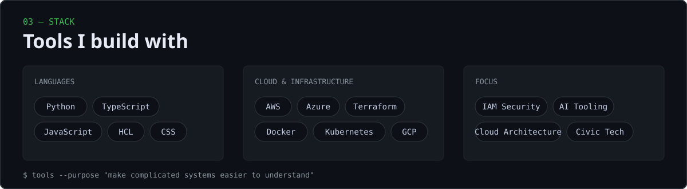

 

 

### `adnannazirahmed@github:~$ python ./scripts/update_stats.py`

 

### `adnannazirahmed@github:~$ cat ./about.md`

 

<!-- contribution-motd:start -->
### `adnannazirahmed@github:~$ motd --cloud-security`

AWS · Azure · IAM · practical defense · refreshed every 12 hours
<!-- contribution-motd:end -->

 

### `adnannazirahmed@github:~$ ls ./projects`

 

**Open a repository:**

 

### `adnannazirahmed@github:~$ cat stack.json`

 

### `adnannazirahmed@github:~$ ./connect.sh`

I enjoy building tools that make complicated systems easier to understand and safer to use.

 

<code>adnannazirahmed@github:~$ echo "build useful things"</code>

